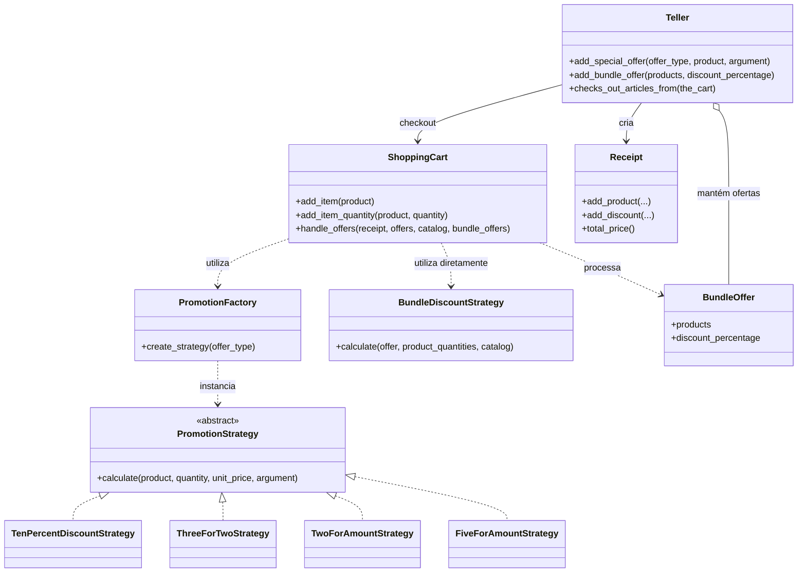

# Padrões de Projeto e Princípios de Qualidade

## 1. Objetivo

Aplicar padrões de projeto e princípios de qualidade para reduzir o acoplamento, organizar as responsabilidades e facilitar a manutenção e a evolução do sistema legado de checkout.

A modernização foi realizada de forma incremental, preservando o comportamento das funcionalidades existentes e permitindo a inclusão de novas regras de negócio, especialmente a promoção de combos.

Foram aplicados os padrões Strategy e Simple Factory (Fábrica Simples), considerando os problemas identificados durante a análise da arquitetura original.

## 2. Padrão Strategy

### Problema identificado

A classe `ShoppingCart`, principalmente no método `handle_offers`, concentrava a lógica de cálculo e aplicação das promoções.

Os diferentes tipos de ofertas eram identificados por meio de estruturas condicionais, tornando o método extenso e aumentando sua complexidade conforme novas regras eram adicionadas.

Essa organização dificultava a manutenção, os testes isolados e a inclusão de novos tipos de promoção.

### Aplicação realizada

O padrão Strategy foi utilizado para encapsular cada regra de cálculo de promoção em uma estratégia independente.

As quatro estratégias de promoções individuais implementam uma abstração comum, permitindo que o sistema execute diferentes regras sem precisar conhecer os detalhes internos de cada cálculo. A estratégia de combos possui uma implementação específica, com responsabilidades e parâmetros próprios para calcular descontos sobre conjuntos de produtos.

Foram implementadas as seguintes estratégias:

- `TenPercentDiscountStrategy`: calcula descontos percentuais.
- `ThreeForTwoStrategy`: calcula a promoção de três produtos pelo preço de dois.
- `TwoForAmountStrategy`: calcula a promoção de dois produtos por um valor definido.
- `FiveForAmountStrategy`: calcula a promoção de cinco produtos por um valor definido.
- `BundleDiscountStrategy`: identifica unidades participantes de combos completos e calcula o desconto correspondente.

A estratégia de combos considera as quantidades necessárias para formar cada combinação, permitindo a formação de múltiplos combos e evitando que unidades excedentes recebam indevidamente o desconto.

Também respeita a regra de exclusividade por unidade definida nos requisitos: unidades utilizadas em combos não recebem simultaneamente promoções individuais incompatíveis, enquanto unidades excedentes continuam elegíveis às ofertas antigas, desde que atendam às suas condições.

### Benefícios obtidos

- Separação das regras de cálculo das promoções.
- Redução de condicionais na lógica central do carrinho.
- Maior isolamento das responsabilidades.
- Facilidade para adicionar novos tipos de promoção.
- Possibilidade de testar cada estratégia individualmente.
- Melhor organização da implementação da nova promoção de combos.

## 3. Padrão Simple Factory (Fábrica Simples)

### Problema identificado

A seleção e a criação dos objetos responsáveis pelas promoções poderiam ficar misturadas com a lógica de execução do checkout.

Quando diferentes estratégias são adicionadas diretamente à lógica principal, o sistema passa a conhecer detalhes de criação e implementação de cada tipo de promoção, aumentando o acoplamento.

### Aplicação realizada

O padrão Simple Factory (Fábrica Simples) foi aplicado por meio da classe `PromotionFactory`, responsável por centralizar a seleção e a criação das estratégias de promoção.

A fábrica recebe o tipo de oferta e utiliza um mapeamento entre os tipos de promoção e suas respectivas classes de estratégia. Em seguida, instancia e retorna a estratégia correspondente.

Caso seja informado um tipo de promoção não suportado, a fábrica lança uma exceção `ValueError`, evitando a criação de estratégias inexistentes.

Essa estrutura mantém a lógica de criação separada da execução dos cálculos e trabalha em conjunto com a abstração comum definida para as estratégias.

### Benefícios obtidos

- Centralização da seleção e criação das estratégias.
- Separação entre criação e execução das promoções.
- Redução do acoplamento entre as classes.
- Facilidade para incluir novos tipos de promoção.
- Organização do processo de seleção das regras.
- Tratamento explícito de tipos de promoção não suportados.

## 4. Princípios SOLID relacionados

A modernização buscou aplicar os seguintes princípios:

- **SRP (Responsabilidade Única):** cada estratégia é responsável por uma regra específica de promoção, evitando a concentração de diferentes cálculos em uma única classe.
- **OCP (Aberto/Fechado):** as estratégias individuais permitem adicionar novas regras de promoção sem concentrar seus cálculos na lógica principal. Entretanto, a inclusão de uma nova estratégia ainda exige atualizar o mapeamento da `PromotionFactory`.
- **DIP (Inversão de Dependência):** as promoções individuais utilizam a abstração `PromotionStrategy`, reduzindo a dependência direta dos detalhes de cada cálculo. Entretanto, a aplicação do princípio é parcial, pois o `ShoppingCart` ainda depende diretamente de classes concretas, como `PromotionFactory` e `BundleDiscountStrategy`.

A aplicação desses princípios é demonstrada pela estrutura implementada e pelos testes automatizados.

## 5. Relação com Clean Code

A modernização também buscou seguir práticas de Clean Code:

- Utilizar nomes claros e significativos para classes, métodos e variáveis.
- Evitar métodos extensos e com múltiplas responsabilidades.
- Reduzir duplicações de código.
- Manter funções pequenas e objetivas.
- Evitar condicionais desnecessárias.
- Organizar as responsabilidades de cada classe.
- Facilitar a leitura, os testes e a compreensão das regras de negócio.

## 6. Validação

A aplicação dos padrões foi validada por meio da implementação no código e de testes automatizados.

A validação contempla:

- Testes individuais das estratégias de promoção.
- Testes de seleção e criação das estratégias pela fábrica.
- Preservação dos comportamentos das promoções antigas.
- Aplicação correta dos descontos em combos completos.
- Ausência de descontos em combos incompletos.
- Tratamento correto de múltiplos combos e unidades excedentes.
- Respeito à regra de exclusividade por unidade.
- Aprovação dos testes de regressão do sistema.

A implementação busca reduzir o acoplamento e melhorar a organização interna do sistema sem comprometer os contratos públicos e o comportamento legado protegido pelos testes de caracterização.

## 7. Diagrama simplificado das classes

O diagrama destaca as responsabilidades das promoções individuais e dos combos. A estratégia de combo aparece separadamente porque, na implementação atual, ela não herda de `PromotionStrategy`.



## 8. Trechos antes e depois da refatoração

### Antes — seleção de promoções por condicionais

O diagnóstico identificou que o método legado `handle_offers` selecionava o cálculo por meio de condicionais baseadas no tipo da oferta. O trecho abaixo é uma representação resumida dessa estrutura, não uma transcrição literal do arquivo original:

```python
# Representação resumida da estrutura legada
if offer.offer_type == SpecialOfferType.TEN_PERCENT_DISCOUNT:
    # calcula desconto percentual
elif offer.offer_type == SpecialOfferType.THREE_FOR_TWO:
    # calcula leve três, pague dois
elif offer.offer_type == SpecialOfferType.TWO_FOR_AMOUNT:
    # calcula duas unidades por valor fixo
elif offer.offer_type == SpecialOfferType.FIVE_FOR_AMOUNT:
    # calcula cinco unidades por valor fixo
```

### Depois — seleção por fábrica e cálculo encapsulado

```python
strategy = PromotionFactory.create_strategy(offer.offer_type)
discount = strategy.calculate(
    product,
    quantity,
    unit_price,
    offer.argument
)
```

Cada estratégia individual implementa `PromotionStrategy`, isolando o cálculo de sua modalidade. A fábrica é uma Simple Factory: centraliza a instanciação por mapeamento, mas não implementa o padrão GoF Factory Method.

## 9. Critério de convivência entre combos e promoções individuais

Os combos são processados antes das promoções individuais. As unidades reservadas para um combo completo não recebem outra promoção individual; as unidades excedentes continuam elegíveis às ofertas individuais cadastradas.

Quando dois combos compartilham produtos, a ordem de cadastro determina a prioridade: o primeiro combo reserva as unidades disponíveis e os seguintes utilizam somente o saldo restante. O sistema não compara automaticamente os descontos para escolher a combinação de maior economia. Essa decisão evita reutilização da mesma unidade e descontos duplicados, mas não garante o menor preço possível ao cliente. A ordem de cadastro deve, portanto, ser considerada na configuração das ofertas.
